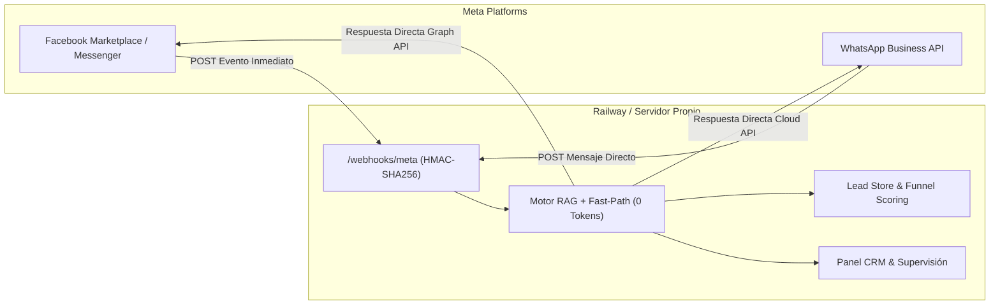

# Guía de Conexión Nativa 100% Gratuita (Sin n8n) — BuyaCAR Omnicanal

Esta arquitectura elimina por completo la necesidad de suscripciones a n8n Cloud o intermediarios externos. El backend en Go (`app_build`) recibe directamente los eventos oficiales de Meta (Facebook Messenger, Marketplace e Instagram) y WhatsApp Cloud API.

---

## 1. Arquitectura Nativa Directa (Costo $0)

---

## 2. Endpoints Nativos Listos en Tu Servidor

Tu servidor expone los endpoints de ingesta directa:

1. **Webhook Facebook Marketplace / Messenger / Instagram**:
   - **URL**: `https://<tu-dominio-railway>/webhooks/meta`
   - **Método GET (Handshake)**: Valida `hub.verify_token` contra `META_VERIFY_TOKEN` (por defecto `buyacar-verify-sim`).
   - **Método POST (Eventos)**: Valida la firma `X-Hub-Signature-256` con `META_APP_SECRET`.
2. **Webhook WhatsApp Cloud API**:
   - **URL**: `https://<tu-dominio-railway>/webhooks/meta` (o configurable en el adaptador `internal/channel/whatsapp_cloud.go`).
   - **Método GET/POST**: Soporta verificación de webhook y mensajes de texto o multimedia.

---

## 3. Configuración en Meta for Developers (Sin Tocar n8n)

1. Ingresa a **[developers.facebook.com](https://developers.facebook.com)** con tu cuenta de negocio.
2. Abre tu App y ve a **Messenger** / **WhatsApp** $\rightarrow$ **Configuración de Webhooks**:
   - **URL de devolución de llamada**: `https://<tu-dominio-railway>/webhooks/meta`
   - **Token de verificación**: `buyacar-verify-sim` (o el que configures en Railway).
   - Haz clic en **Verificar y Guardar**.
3. En **Campos de suscripción**, activa:
   - `messages`
   - `messaging_postbacks`
4. Selecciona tu Fan Page oficial de BuyaCAR o tu número de WhatsApp y suscríbela al webhook.

---

## 4. Variables en Railway para Modo Nativo

En tu servicio de Railway (pestaña **Variables**), solo necesitas:

| Variable | Valor | Propósito |
| :--- | :--- | :--- |
| `BUYACAR_OPERATING_MODE` | `DRAFT` o `AUTOPILOT` | Modo de supervisión o envío autónomo |
| `BUYACAR_LIVE_INVENTORY_SYNC` | `1` | Lectura en tiempo real de buyacar.com.co |
| `META_PAGE_ID` | Tu ID numérico de página | Identificador oficial de Facebook |
| `META_ACCESS_TOKEN` | Token de acceso de la página | Permiso para enviar respuestas salientes |
| `META_APP_SECRET` | Clave secreta de la app | Validación criptográfica HMAC-SHA256 |
| `META_VERIFY_TOKEN` | `buyacar-verify-sim` | Token de sincronización con Meta |
| `BUYACAR_ADMIN_PASSWORD` | Tu contraseña elegida | Acceso seguro al panel de control CRM |

---

## 5. Ventajas de la Solución Nativa
- **Cero suscripciones recurrentes**: Costo permanente de \$0 en herramientas de automatización.
- **Latencia mínima**: Las consultas se procesan en menos de 5 ms localmente por Fast-Path.
- **Sin caídas por terceros**: No dependes de la cuota ni del estado de servicio de n8n Cloud.
- **Captura directa de leads**: El teléfono del cliente se guarda inmediatamente en la memoria del CRM para seguimiento en Tunja.
